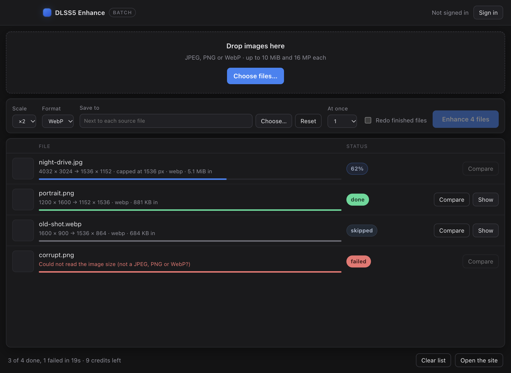

# DLSS5 Enhance — the desktop window

A window around the same engine the command line uses. Drop a folder of pictures, watch each one
move from queued to done, and open a before/after pair when it lands. Same account, same public API,
same credits as [dlss5nvidia.com](https://www.dlss5nvidia.com/visual-enhancer) — nothing is
re-implemented here, `src/batch.mjs` does the work and this shell only shows it.



## Run it

```bash
cd desktop
npm install     # Electron only, as a dev dependency; the CLI itself still has none
npm start
```

## What it does that a browser tab cannot

- **A whole folder at once** — drop files on the window or pick them with the system dialog; the
  queue survives a long run.
- **The plan before the cost** — every row shows the source size, the size that will actually come
  back (the 1536 px edge caps a ×4 request), the format and the file weight, before anything is
  sent.
- **Skipping is the default** — a file whose `<name>-enhanced.<ext>` already exists is skipped and
  not charged again. "Redo finished files" turns that off.
- **Failures stay in the list** — a broken file or an upstream error marks its own row and the rest
  of the batch keeps going.
- **Before / after** — "Compare" opens the source and the result side by side at full width.

## How it is put together

| File | Role |
|---|---|
| `main.mjs` | The Electron main process: windows, dialogs, the token, the batch engine, `dlss5file://` for previews. |
| `preload.cjs` | The whole bridge: 12 calls, no node in the page. |
| `renderer/` | The page — plain HTML, CSS and one ES module, no framework, no bundler. |
| `../src/batch.mjs` | The engine both this window and the terminal run. |

Hardening that is on by default: `contextIsolation`, `sandbox`, `nodeIntegration: false`, a CSP with
no remote origins, and a custom protocol that serves only the paths the user picked. The session is
the same refresh token in `~/.config/dlss5-enhance/credentials.json` (mode `0600`) that the CLI
writes, so signing in through one signs in the other.

## Checking it without clicking

```bash
npm run smoke                          # opens the window, drives the real page, prints a self-test
npm run smoke -- --shot=/tmp/ui.png    # …and writes a picture of it
npm run smoke -- --demo                # fabricated rows, to look at every state without an account
```

`--e2e --file=<image>` goes further: it signs a throwaway account up, pushes one real image through
the window's own buttons and waits for the row to settle. That run is what proved the whole path —
1440 × 778 JPEG in, 1536 × 832 WebP out in 17 s — and what caught two bugs a unit test could not:
a `done` event that lost the file it belonged to, and an idempotency key that collided with the same
picture under a different account.

## Not yet

- No `.dmg` / `.exe` yet: `electron-builder` packaging is the next step, and the Windows build needs a
  Windows machine or Wine.
- The window shows one queue at a time and does not remember the last folder between launches.
